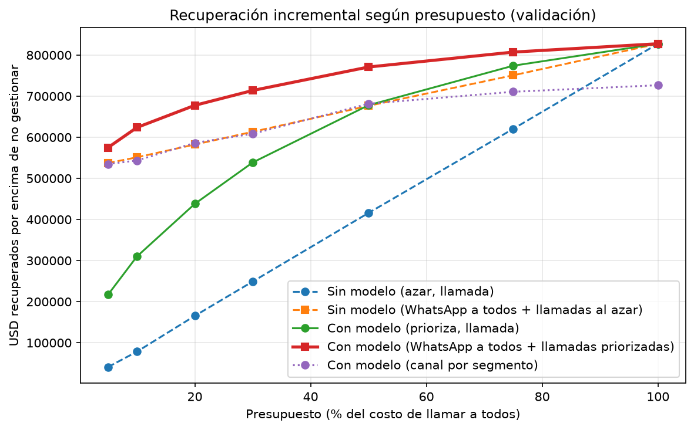
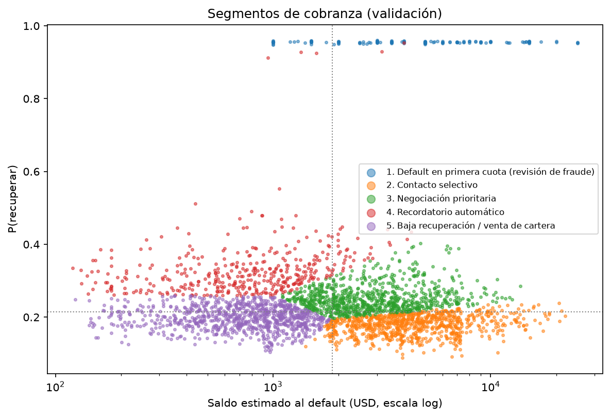
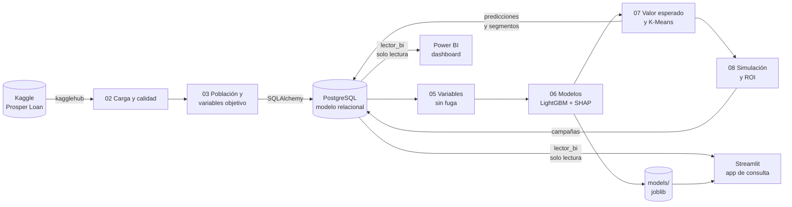

# 💼 Optimización de cobranza y recuperación de cartera con aprendizaje por segmentos


> **Proyecto II — Especialización en Ciencia de Datos e Inteligencia Artificial.**
> Un modelo que estima qué deudores en mora tienen más probabilidad de pagar y cuánto se espera recuperar, los agrupa en segmentos con una acción y un canal de cobranza, y demuestra con una simulación cuánto más se recupera **con el mismo presupuesto**.

---

## 1. El problema

En cobranza de cartera castigada, la mayoría de los esfuerzos no recupera nada. En el dataset Prosper, de **17.010 créditos castigados (USD 79,8 millones de exposición), solo el 21,7 % recuperó algo, y en total se recuperaron USD 5,1 millones (6,4 %)**. Gestionar a todos con la misma intensidad desperdicia unos 4 de cada 5 contactos.

**Pregunta de negocio:** con un presupuesto limitado, *¿a quién contactar, con qué canal y en qué orden?*
**Métrica de negocio:** dólares recuperados (por encima de no gestionar) por cada dólar invertido en cobranza.

## 2. Resultados principales

Todos los resultados se miden en **validación temporal**: 3.163 créditos cerrados entre 2010 y 2012 que el modelo **nunca vio** al entrenar.

| Resultado | Valor |
|---|---|
| **Ganancia frente a la mejor estrategia sin modelo, con el mismo presupuesto y los mismos canales** | **+16,4 %** (USD 714 mil frente a 613 mil, con el 30 % del presupuesto) |
| Escenarios de supuestos en los que el modelo gana (análisis de sensibilidad) | **10 de 10** |
| % de lo que se recuperaría llamando a todos, logrado con el 30 % del presupuesto | **86 %** |
| USD recuperados en el 20 % de la cartera priorizado por el modelo | **52,9 %** (al azar: 22,6 %) |
| Lo mismo, excluyendo el grupo de posible fraude (FPD) | **45,8 %** (al azar: 18,6 %) |
| AUC · PR-AUC · Brier (modelo de recuperación, LightGBM) | 0,646 · 0,517 (azar: 0,297) · 0,186 (tasa base: 0,209) |
| Lift del decil superior | ≈ 2,2× |

**Segmentos de cobranza** (validación, resultados reales):

| Segmento | % de créditos | % de USD recuperados | USD por crédito | Acción |
|---|---|---|---|---|
| 1. Default en primera cuota | 4 % | 21 % | 1.885 | Revisión de fraude antes de cobrar |
| 2. Contacto selectivo | 27 % | 32 % | 443 | Llamada de diagnóstico |
| 3. Negociación prioritaria | 27 % | 29 % | 410 | Asesor y acuerdo de pago |
| 4. Recordatorio automático | 13 % | 10 % | 288 | WhatsApp |
| 5. Baja recuperación | 29 % | **7 %** | 94 | No gestionar intensivamente / evaluar venta |

<p align="center">
  
  
</p>

> ⚠️ **Canales, costos y efectividades son SIMULADOS.** Prosper no registra gestiones de cobranza. Los supuestos están en [`src/supuestos.py`](src/supuestos.py) y se sometieron a un análisis de sensibilidad.

## 3. Arquitectura



- **Base de datos:** 9 tablas y 5 vistas en PostgreSQL, con llaves foráneas, restricciones `CHECK` e índices. Ver el [diagrama entidad-relación y su justificación](docs/modelo_er.md).
- **Seguridad:** el dashboard y la aplicación usan un rol de **solo lectura** que no puede ver las tablas con datos personales. Las credenciales viven en `.env` y nunca en el repositorio.
- **Código:** la lógica reutilizable está en [`src/`](src) y la importan los notebooks y la aplicación, así que no hay lógica duplicada.

## 4. Metodología (resumen)

1. **Momento de predicción = entrada a cobranza.** Solo se usa información conocida en ese instante. Hay **tres controles automáticos contra la fuga de datos**: una lista negra que hace fallar el código, una prueba de estabilidad entre épocas y un detector de AUC univariado.
2. **Ventana de maduración de 24 meses:** se excluyen los créditos castigados demasiado recientes para conocer su recuperación (censura).
3. **Validación temporal:** se entrena con cierres de 2006 a 2009 y se valida con cierres de 2010 a 2012. La validación **no se usa para ajustar nada**.
4. **Modelos:** regresión logística (línea base) frente a LightGBM, con calibración de Platt y explicación con SHAP. Se probó una segunda etapa para predecir *cuánto* se recupera, pero se descartó porque no mejoraba la priorización.
5. **Segmentación:** una regla de negocio (*First Payment Default* = posible fraude) más K-Means sobre la probabilidad y el saldo.
6. **Simulación de ROI** con el mismo presupuesto, frente a la mejor estrategia sin modelo, con un análisis de sensibilidad de 10 escenarios.

Cada decisión, con la evidencia que la respalda, está en el [**registro de decisiones**](docs/decisiones.md).

## 5. Cómo reproducirlo desde cero (Windows)

**Requisitos:** Python 3.12, Git, PostgreSQL 17 y una cuenta de Kaggle.

```powershell
# 1. Clonar y crear el entorno
git clone https://github.com/jonathanrpo17-creator/cobranza-ml.git
cd cobranza-ml
py -3.12 -m venv .venv
.venv\Scripts\Activate.ps1
pip install -r requirements.txt

# 2. Configurar credenciales (editar .env con tus valores reales)
copy .env.example .env

# 3. Ejecutar todo el proyecto (notebooks 01 a 09, unos 5 minutos)
python scripts/ejecutar_todo.py

# 4. Pruebas automáticas
pytest -v

# 5. Aplicación de consulta
streamlit run app/app.py
```

El dashboard se construye siguiendo la [guía de Power BI](docs/guia_powerbi.md). También hay una [versión en PDF](powerbi/) para quien no tenga Power BI.

## 6. Estructura del repositorio

```
app/        aplicación de consulta (Streamlit)
data/       datos — no se versionan; ver data/README.md
docs/       decisiones, modelo E-R, guía de Power BI, métricas (CSV) y figuras
models/     contrato de variables y métricas (los .joblib se regeneran con los notebooks)
notebooks/  01_entorno → 09_publicacion, en orden de ejecución
powerbi/    dashboard .pbix y PDF exportado
scripts/    ejecutar_todo.py (reproducibilidad) · revisar_secretos.py (seguridad)
sql/        esquema, índices, vistas, permisos y consultas de ejemplo
src/        código reutilizable: datos, objetivo, BD, variables, modelos, métricas,
            segmentación, simulación y servicio de la app
tests/      pruebas automáticas (pytest), ejecutadas en GitHub Actions
```

## 7. Limitaciones

- **Datos de EE. UU. (Prosper, 2005–2014).** No representan directamente la cartera colombiana. La ruta de adaptación está en la documentación de la Fase 11.
- **Gestión de cobranza simulada.** Canales, costos y efectividades son supuestos. El valor de la *priorización* se sostiene en los 10 escenarios probados, pero la cifra exacta de ROI depende de esos supuestos.
- **Señal moderada** (AUC 0,646): el modelo ordena bien la cartera, pero no predice con certeza quién paga.
- **Cambio entre periodos.** Las recuperaciones de la validación son mayores que las del entrenamiento, así que el modelo es **conservador** (subestima un 23 % los USD recuperados).
- **El grupo FPD probablemente refleja recompras de la plataforma**, no cobranza. Por eso los resultados se reportan con y sin ese grupo.
- **Plazos distintos de 36 meses:** el modelo extrapola, y la aplicación lo advierte.
- **Decisiones irreversibles** (como vender cartera) **requieren revisión humana.** La optimización automática con datos de otro periodo habría vendido un segmento valioso.

## 8. Equipo

| Integrante | Rol en el proyecto |
|
| Leydi Tatiana Arboleda 
| Jonathan Restrepo Jaramillo 
| Cindy Velásquez Castaño 

Especialización en Ciencia de Datos e IA · 2026 · Licencia [MIT](LICENSE)
