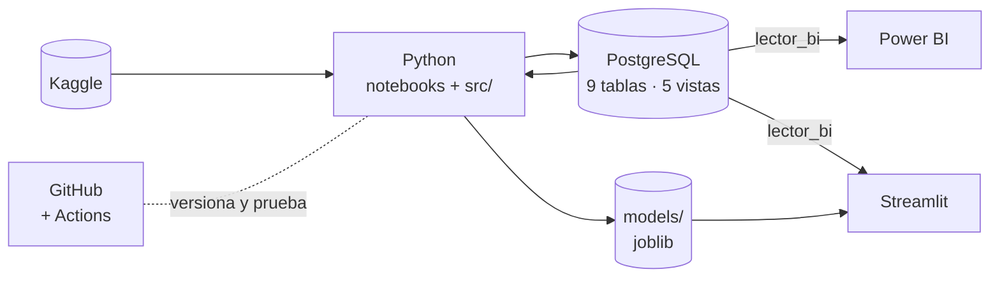

# Documentación del proyecto

**Optimización de cobranza y recuperación de cartera con aprendizaje por segmentos**

Este documento cubre los componentes que el curso pide documentar: **riesgos y obstáculos**, **enfoque de datos**, **gestión de la información** (calidad, accesibilidad, gobernanza y marco legal colombiano), **arquitectura y recursos** y **plan de expansión** con datos reales colombianos. Cada afirmación técnica remite a la decisión del [registro de decisiones](decisiones.md) que la respalda (D1 a D60).

> El análisis normativo de la sección 3.4 es informativo y lo elaboró un equipo de ciencia de datos. No constituye asesoría jurídica. Una implementación real debe validarse con el área legal y de cumplimiento de la entidad.

---

## 1. Riesgos y obstáculos

### 1.1 Riesgos técnicos y de negocio

| # | Riesgo | Impacto si no se controla | Mitigación aplicada | Evidencia |
|---|---|---|---|---|
| R1 | **Fuga de datos:** usar información posterior a la entrada a cobranza | Métricas infladas; el modelo fallaría en producción | Momento de predicción definido; lista negra que hace fallar el código; diccionario como única fuente de verdad; pruebas automáticas; AUC univariado (máximo 0,547, ninguna variable sospechosa) | D3, D4, D22, D25 |
| R2 | **Censura:** créditos castigados hace poco aún no muestran sus recuperaciones | Objetivo mal medido; los créditos recientes parecerían malos deudores | Ventana de maduración de 24 meses, elegida con curva y análisis de sensibilidad | D10 |
| R3 | **Variables que dependen de la época** (Prosper cambió formularios y etiquetas) | El modelo aprende "el año" en vez del deudor | Control de estabilidad entre épocas: se excluyeron 11 variables del bureau, `proposito`, `situacion_laboral`, `estado_residencia` y `ocupacion` | D22, D25, D33 |
| R4 | **Cambio entre periodos:** la validación recupera más que el entrenamiento | Probabilidades descalibradas en el nivel | Validación temporal estricta; se reporta que el modelo es **conservador** (subestima un 23 % los USD); el orden de la cartera, que es lo que importa, se mantiene | D19, D29, D46 |
| R5 | **Señal moderada** (AUC 0,646) | Sobreprometer precisión individual | El valor se mide como **priorización** (lift, ganancia, ROI) y no como certeza por deudor | D34, D53 |
| R6 | **El grupo FPD es probablemente una recompra de la plataforma, no cobranza** | Atribuir al modelo dinero que no viene de gestionar | Segmento propio por regla de negocio; resultados reportados **con y sin FPD** (sin FPD: 45,8 % de los USD en el top 20 %, frente a 18,6 % al azar) | D44, D46 |
| R7 | **Gestión de cobranza simulada:** Prosper no registra canales ni costos | El ROI depende de los supuestos | Supuestos explícitos en código; análisis de sensibilidad con 10 escenarios (el modelo gana en todos); comparación contra la **mejor** estrategia sin modelo | D47 a D53 |
| R8 | **Decisiones irreversibles automatizadas** | La optimización automática habría **vendido** un segmento que aporta el 32 % de los USD | La venta de cartera y el canal por segmento quedan como **recomendación con revisión humana**, no como decisión automática | D51 |
| R9 | **Extrapolación:** el 99,8 % del entrenamiento es a 36 meses | Predicciones poco confiables para otros plazos | La aplicación advierte cuando el plazo no es de 36 meses | D13, D54 |
| R10 | **Sesgo y equidad:** variables que actúan como proxy de grupos | Trato desigual en la gestión de cobranza | Se excluyeron la ubicación geográfica y la ocupación; el modelo no usa variables sensibles; SHAP explica cada predicción | D33, D35 |
| R11 | **Deriva del modelo** cuando cambian la economía o la política de cobranza | Pérdida gradual de efectividad | Versionado del modelo en la base (`modelo_version`, `es_vigente`); en producción: monitoreo y reentrenamiento (sección 5) | D39 |
| R12 | **Cumplimiento de la Ley 2300 de 2023** (horarios y frecuencia de contacto) | Sanciones; daño reputacional | La estrategia multicanal debe escalonarse por semanas (sección 3.4) | Sección 3.4 |
| R13 | **Datos de EE. UU.** | Resultados no trasladables a Colombia sin reentrenar | El método es transferible, no los coeficientes; plan de expansión con datos colombianos | Sección 5 |

### 1.2 Obstáculos del proceso y cómo se resolvieron

| Obstáculo | Resolución |
|---|---|
| Equipo sin experiencia previa en Git ni GitHub | Flujo de ramas por fase con *pull requests*, commits convencionales y tags por hito (`v0.1-pitch`, `v0.2-avances`) |
| Fechas con formatos mixtos (`DateCreditPulled` con 74,7 % de nulos falsos) | `format="mixed"` y una validación que reporta las fechas perdidas | D2 |
| Credenciales de Kaggle expuestas dos veces durante el desarrollo | Los tokens se revocaron; los secretos solo viven en `.env`; un auditor recorre **todo el historial** antes de publicar (✅ limpio) | D58 |
| El saldo estimado daba 0 en 515 créditos (fórmula y cuotas reportadas en 0) | Supuesto de 4 cuotas impagas al default, piso con la cuota contractual y pruebas automáticas | D40, D43 |
| La primera segmentación quedó dominada por grupos extremos | Regla FPD previa; k entre 4 y 6 con tamaño mínimo del 3 % | D41, D44 |
| Una comparación de ROI que mezclaba el efecto del modelo con el de los canales | Línea base sin modelo con canales baratos y comparación con **la misma mezcla de canales** (declarada como agregada después) | D49, D52 |

---

## 2. Enfoque de datos

| Elemento | Definición |
|---|---|
| **Fuente** | Prosper Loan Data (Kaggle): 113.937 créditos persona a persona, EE. UU., 2005–2014, 81 variables |
| **Unidad de análisis** | Crédito en cobranza (con deudor asociado: 15.811 deudores) |
| **Población** | Créditos castigados (*Chargedoff*) o en default (*Defaulted*): **17.010 créditos, USD 79,8 M de exposición** |
| **Momento de predicción** | La entrada a cobranza. Solo se usa información de la solicitud, la originación y el comportamiento de pago hasta el default |
| **Objetivo A** | ¿Se recupera algo después del castigo (≥ USD 1)? Línea base: 21,65 % de los créditos |
| **Objetivo B** | Tasa de recuperación sobre la exposición (se evaluó y se descartó para priorizar) |
| **Exposición conocida al entrar a cobranza** | Saldo contractual estimado al default (amortización francesa, 4 cuotas impagas) |
| **Partición** | Temporal por año de cierre: entrenamiento 2006–2009 (8.543), validación 2010–2012 (3.163); cartera inmadura para priorizar (5.196) |
| **Variables finales** | 33 numéricas: comportamiento de pago antes del default, central de riesgo, capacidad de pago, condiciones del crédito e historial con Prosper |
| **Modelos** | Regresión logística (línea base) y LightGBM con calibración de Platt; SHAP; K-Means con una regla de negocio previa |
| **Métricas** | AUC, PR-AUC, Brier y calibración (técnicas); lift por decil, ganancia acumulada en USD y USD recuperados por USD invertido con el mismo presupuesto (de negocio) |

---

## 3. Gestión de la información

### 3.1 Calidad

La calidad se controla en **cinco capas**, de la fuente al consumo:

1. **Perfilamiento de la fuente** (notebook 02): dimensiones verificadas, duplicados exactos y por llave, nulos por columna, rango de fechas y existencia de las columnas de fuga.
2. **Depuración documentada** (notebook 03): 871 duplicados de `LoanKey` resueltos con una regla conservadora; chequeos de consistencia de las columnas de recuperación (pérdida neta mayor que la bruta: 11,6 %; recuperación mayor que la exposición: 3,7 %; exposición nula: 0,6 %) con una decisión explícita para cada caso.
3. **Reglas dentro de la base de datos** (notebook 04): llaves foráneas, `UNIQUE` y `CHECK` (objetivo A ∈ {0, 1}, tasas y probabilidades entre 0 y 1, montos no negativos). La base **rechaza** datos inválidos, y eso se prueba insertándolos a propósito.
4. **Validación de la carga:** conteos y sumas de control entre pandas y PostgreSQL. 8 de 8 coinciden.
5. **Pruebas automáticas y reproducibilidad:** 18 pruebas en cada cambio (GitHub Actions); el proyecto completo se reproduce con un comando en unos 3 minutos; la aplicación reproduce exactamente las predicciones guardadas (diferencia menor que 1e-5).

### 3.2 Accesibilidad

| Usuario | Acceso | Cómo |
|---|---|---|
| Gerencia y analistas | Dashboard | Power BI Desktop conectado con un rol de solo lectura; también en PDF |
| Equipo de cobranza | Aplicación de consulta | Streamlit: consulta por deudor, explicación SHAP, lista de gestión descargable |
| Científicos de datos | Base de datos y código | PostgreSQL (vistas de consumo), repositorio público, notebooks numerados |
| Auditoría o jurado | Trazabilidad | Registro de decisiones, métricas en CSV y tags de Git por hito |

### 3.3 Gobernanza

- **Linaje de los datos:** Kaggle → `data/raw` (inmutable) → `data/interim` (parquet) → PostgreSQL (fuente única de verdad desde la Fase 4) → modelos (`models/`) → predicciones y campañas en PostgreSQL → aplicación y dashboard.
- **Separación por sensibilidad:** el desenlace (que contiene fuga de datos) vive en una tabla aparte (`resultados_recuperacion`) y la foto del deudor en otra (`perfil_solicitud`).
- **Mínimo privilegio:** el rol `lector_bi` solo lee vistas y catálogos. No ve `creditos`, `perfil_solicitud`, `resultados_recuperacion` ni `deudores`, ni puede modificar nada. Está verificado en el notebook 09.
- **Minimización:** la vista de la aplicación (`vw_entradas_modelo`) excluye los identificadores de persona (`member_key`, `group_key`) y todo desenlace.
- **Seudonimización:** los identificadores son llaves alfanuméricas sin datos de contacto. El dataset no contiene nombres, documentos ni teléfonos.
- **Gestión de secretos:** las credenciales viven en `.env` (ignorado por Git); la plantilla `.env.example` es pública; el historial completo se audita antes de publicar.
- **Versionado:** código en Git, con ramas por tarea, *pull requests* y tags por hito; modelos versionados en la tabla `predicciones` (`modelo_version`, `es_vigente`).
- **Trazabilidad de decisiones:** más de 60 decisiones registradas con su evidencia.

### 3.4 Marco legal colombiano aplicable

El dataset de Prosper es público, de EE. UU. y seudonimizado, así que la normativa colombiana **no se aplica a este prototipo**. Sí se aplicaría a una implementación con datos de deudores colombianos. Esta tabla resume las normas pertinentes y cómo se adaptaría el proyecto.

| Norma | Qué exige (resumen) | Implicación para el proyecto |
|---|---|---|
| **Ley Estatutaria 1581 de 2012** (protección de datos personales), reglamentada por el Decreto 1377 de 2013 (compilado en el Decreto 1074 de 2015) | Principios de legalidad, **finalidad**, libertad, veracidad, transparencia, acceso y circulación restringida, **seguridad** y confidencialidad; autorización previa del titular; derechos a conocer, actualizar, rectificar y suprimir sus datos; política de tratamiento | La finalidad "gestión de cobranza y priorización" debe estar en la autorización y en la política de tratamiento de la entidad. Las medidas de seguridad ya implementadas (mínimo privilegio, minimización, secretos fuera del código) son el punto de partida |
| **Ley 1266 de 2008** (hábeas data financiero), modificada por la **Ley 2157 de 2021** | La información de las centrales de riesgo **no puede usarse para fines distintos al análisis o cálculo del riesgo crediticio**; las decisiones no pueden basarse **exclusivamente** en la información de incumplimiento; el dato negativo permanece el doble del tiempo de la mora (máximo 4 años desde el pago) y caduca a los 8 años desde la mora; comunicación previa al reporte negativo | **Punto a validar con el área legal:** si usar variables del bureau para *priorizar la cobranza* se enmarca en el "riesgo crediticio". El modelo no decide solo con el incumplimiento, pues combina comportamiento de pago, capacidad de pago y condiciones del crédito |
| **Ley 2300 de 2023** ("Dejen de fregar") | Contactar solo por los **canales que el consumidor autorice**; lunes a viernes de 7:00 a. m. a 7:00 p. m. y sábados de 8:00 a. m. a 3:00 p. m.; nunca domingos ni festivos; no más de una vez al día y, una vez hay contacto directo, no por varios canales en la misma semana; prohibido contactar a las referencias personales | **Ajuste a la estrategia de la Fase 8:** "WhatsApp a todos + llamadas priorizadas" debe **escalonarse**. Primero el WhatsApp; la llamada se hace en otra semana y solo si no hubo contacto efectivo. El optimizador de producción debe incluir estas restricciones (canal autorizado, horario y frecuencia) |
| **Circular Externa 002 de 2024 de la SIC** (datos personales en sistemas de IA) | Antes de tratar datos personales con IA, ponderar **idoneidad, necesidad, razonabilidad y proporcionalidad**, en el marco de las Leyes 1266 y 1581 | Justificación documentada: el modelo es **idóneo** (2,2× de lift), **necesario** (usa 33 variables y excluyó las de época y geografía) y **proporcional** (prioriza el contacto; no niega derechos ni crédito). Se recomienda un estudio de impacto antes de producción |
| **CONPES 4144 de 2025** (Política Nacional de Inteligencia Artificial) | Marco de política pública para el desarrollo y uso ético y responsable de la IA en Colombia | El proyecto aplica principios coherentes con ella: explicabilidad (SHAP por deudor), supervisión humana en las decisiones irreversibles y transparencia en los supuestos |

---

## 4. Arquitectura y recursos

### 4.1 Arquitectura

El detalle del modelo relacional y su justificación está en [modelo_er.md](modelo_er.md).

### 4.2 Recursos

| Recurso | Detalle | Costo |
|---|---|---|
| Lenguaje y librerías | Python 3.12: pandas, scikit-learn, LightGBM, SHAP, SQLAlchemy, Streamlit, pytest | USD 0 (código abierto) |
| Base de datos | PostgreSQL 17 local | USD 0 |
| Visualización | Power BI Desktop | USD 0 (versión gratuita; se comparte por `.pbix`, PDF y video) |
| Versionado y CI | GitHub (repositorio público) y GitHub Actions | USD 0 |
| Hardware | Portátil con Windows 11 y 16 GB de RAM; el proyecto completo se reproduce en **2,6 minutos** | Equipo existente |
| Equipo humano | 3 integrantes; ciclo de unas 4 semanas (pitch el 27 de octubre, final el 25 de noviembre) | — |

**Estimación para producción (orientativa):** un PostgreSQL administrado en la nube, un servicio de contenedores para la aplicación y reentrenamiento programado. Corresponde a la ruta de la sección 5 y a un costo mensual bajo frente al valor recuperado.

---

## 5. Plan de expansión con datos reales colombianos

El **método** es transferible: momento de predicción, controles anti-fuga, validación temporal, priorización por valor esperado y simulación con el mismo presupuesto. Los **coeficientes** no lo son, porque el modelo debe reentrenarse con datos colombianos.

### 5.1 Fuentes de datos

| Fuente | Qué aporta | Limitación |
|---|---|---|
| **Cartera propia de la entidad** (historial de pagos, altura de mora, acuerdos) | Reemplaza los datos de Prosper a nivel de deudor | Requiere autorización de tratamiento con finalidad de cobranza (Ley 1581) |
| **Registro de gestiones de cobranza** (canal, fecha, resultado, costo) | Reemplaza los **supuestos simulados** por efectividades y costos **reales** | Hoy no existe en el dataset; es el insumo de mayor valor |
| **Centrales de riesgo** (Datacrédito Experian, TransUnion) | Variables de bureau actualizadas | Uso restringido al riesgo crediticio (Ley 1266/2157): validar con el área legal |
| **Datos abiertos de la Superintendencia Financiera** (*Evolución de la cartera de créditos*: por modalidad, departamento y sector, con saldos en mora y en riesgo) | Calibración del nivel de recuperación por modalidad y región; monitoreo del entorno | Datos **agregados**, no por deudor: sirven de referencia, no para entrenar |

### 5.2 Equivalencias de variables

| Prosper (prototipo) | Equivalente en Colombia |
|---|---|
| `LoanFirstDefaultedCycleNumber` (cuota del primer default) | Cuotas pagadas antes de la mora / altura de mora al iniciar la cobranza |
| `ProsperRating` / `CreditGrade` | Calificación de riesgo de la entidad (A a E) |
| `CreditScoreRange` | Puntaje de la central de riesgo |
| `DelinquenciesLast7Years`, `InquiriesLast6Months` | Historial de moras y consultas en la central de riesgo |
| `StatedMonthlyIncome`, `DebtToIncomeRatio` | Ingresos y endeudamiento reportados en la solicitud |
| `LP_GrossPrincipalLoss` / recuperaciones | Saldo castigado y pagos posteriores al castigo |

### 5.3 Hoja de ruta

| Etapa | Qué se hace | Resultado esperado |
|---|---|---|
| **1. Piloto con datos históricos** (2–3 meses) | Reentrenar con la cartera castigada de una entidad; repetir los controles de fuga, estabilidad y maduración | Un modelo colombiano validado en un periodo no visto |
| **2. Experimento controlado** (3 meses) | Prueba A/B: un grupo gestionado con el modelo y otro con la estrategia actual, **con el mismo presupuesto** | ROI **medido**, ya no simulado; efectividades reales por canal |
| **3. Cumplimiento integrado** | Restricciones de la Ley 2300 en el optimizador (canal autorizado, horario, frecuencia, escalonamiento semanal); estudio de impacto según la Circular 002 de 2024 de la SIC | Una estrategia legalmente ejecutable |
| **4. Producción** | Base y aplicación en la nube; seguimiento de experimentos (MLflow); monitoreo de deriva y reentrenamiento periódico; versionado del modelo en la tabla `predicciones` | Operación continua y auditable |
| **5. Ampliación** | Otras modalidades (consumo, microcrédito, comercial pyme) y modelos de *uplift* para estimar el efecto **causal** de cada canal | Pasar de "a quién llamar" a "qué acción cambia el resultado de cada deudor" |

---

## Fuentes normativas consultadas

- [Ley 2300 de 2023 — texto oficial (normograma MinTIC)](https://normograma.mintic.gov.co/docs/pdf/ley_2300_2023.pdf)
- [Ley 2157 de 2021 — texto compilado (Colpensiones)](https://normativa.colpensiones.gov.co/compilacion/docs/ley_2157_2021.htm)
- [Circular Externa 002 de 2024, SIC — datos personales en sistemas de IA](https://sedeelectronica.sic.gov.co/sites/default/files/normativa/Circular%20Externa%20No.%20002%20del%2021%20de%20agosto%20de%202024.pdf)
- [CONPES 4144 de 2025 — Política Nacional de Inteligencia Artificial](https://ambitojuridico.com/sites/default/files/2025-02/Conpes-4144-2025.pdf)
- [Superintendencia Financiera — Estadísticas de la evolución de la cartera de créditos](https://www.superfinanciera.gov.co/publicaciones/10115251/estadisticas-de-la-evolucion-de-la-cartera-de-creditos/)
