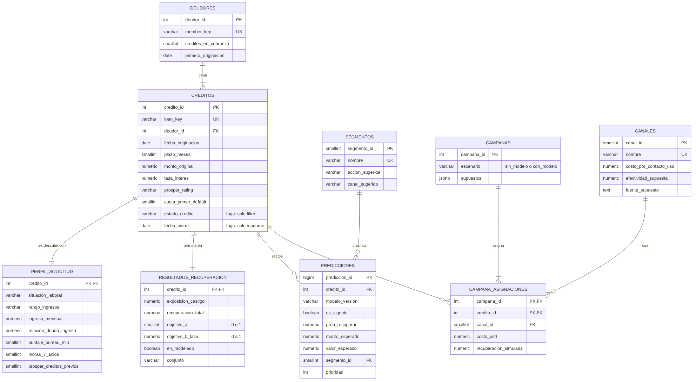
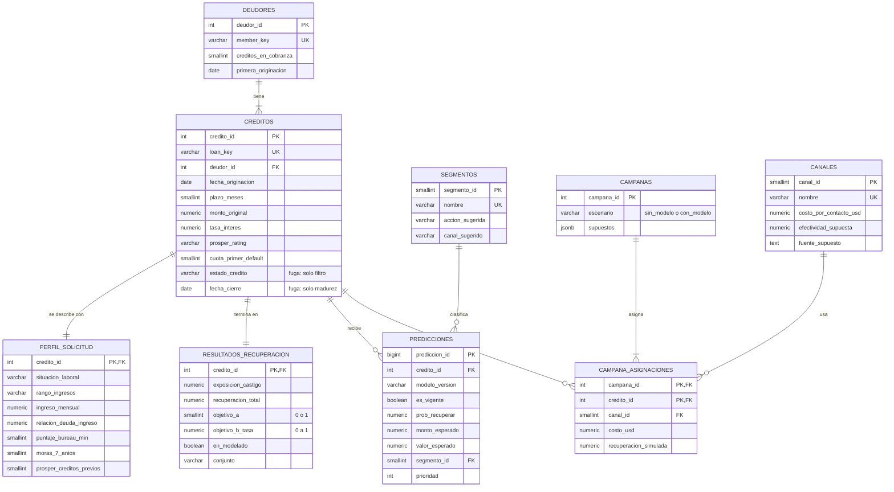

# Modelo de datos — Arquitectura de la base PostgreSQL

Código fuente del diagrama (Mermaid; GitHub lo dibuja automáticamente)

## Tablas y propósito

| Grupo | Tabla | Grano (una fila por…) | Se llena en |
|---|---|---|---|
| Datos de origen | `deudores` | persona (MemberKey) | Fase 4 |
| | `creditos` | crédito en cobranza | Fase 4 |
| | `perfil_solicitud` | crédito (foto del deudor al solicitar) | Fase 4 |
| Desenlace | `resultados_recuperacion` | crédito (objetivos A y B) | Fase 4 |
| Catálogos | `segmentos`, `canales` | segmento / canal | Fases 7–8 |
| Modelo | `predicciones` | crédito × versión del modelo | Fases 6–7 |
| Simulación | `campanas`, `campana_asignaciones` | campaña / crédito × campaña | Fase 8 |

Vistas de consumo: `vw_cartera_cobranza` (una fila por crédito, para Power BI y la aplicación) y `vw_resumen_cohortes` (resumen por año de cierre y estado).

## Decisiones de diseño y su justificación

**1. `deudores` separado de `creditos` (relación 1:N).** Un mismo deudor puede tener varios créditos en cobranza (el dataset completo tiene 113.066 créditos y 90.831 deudores). Separarlos evita repetir datos y prepara el caso real: en cobranza se gestiona a la **persona**, no al crédito suelto.

**2. `perfil_solicitud` separado de `deudores` (relación 1:1 con `creditos`).** Ingresos, empleo y puntaje de bureau son una **foto tomada en cada solicitud**: cambian de un crédito a otro. Dependen del crédito, no de la persona, y por eso van con el crédito (tercera forma normal). También separa las condiciones del producto de la información personal, lo que facilita dar permisos distintos.

**3. `resultados_recuperacion` aislado.** Contiene las columnas con **fuga de datos** (LP_*) y las variables objetivo. Tenerlas en una tabla aparte hace visible la regla anti-fuga: el modelo lee sus entradas de `creditos` y `perfil_solicitud`, y el objetivo de aquí.

**4. `predicciones` con versión del modelo.** La llave `(credito_id, modelo_version)` permite guardar varias versiones y comparar modelos sin borrar historia. El campo `es_vigente` indica cuál usan el dashboard y la aplicación.

**5. Canales y campañas como tablas, con los supuestos documentados.** Prosper no trae datos de gestión de cobranza, así que todo lo relativo a canales es **simulado**. `canales.fuente_supuesto` y `campanas.supuestos` (JSONB) dejan trazado cada supuesto de costo y efectividad.

**6. Reglas de calidad dentro de la base.**
- Llaves foráneas: no puede existir un crédito sin deudor.
- `UNIQUE`: no hay créditos ni deudores duplicados.
- `CHECK`: el objetivo A solo vale 0 o 1; las tasas y probabilidades están entre 0 y 1; los montos no son negativos.

El notebook 04 inserta datos inválidos a propósito y verifica que la base los **rechace**.

**7. Llaves sustitutas enteras** (`credito_id`, `deudor_id`) además de las llaves naturales de Prosper (`loan_key`, `member_key`). Hacen más rápidas las uniones y desacoplan el modelo de los identificadores del proveedor de datos.

**8. Índices pensados para las consultas reales.** Incluyen la partición temporal (`fecha_cierre`), el ranking de priorización (`valor_esperado DESC`) y dos índices parciales: la población de modelado y la predicción vigente.

**9. Vistas como capa de consumo.** Power BI y la aplicación leen vistas, no tablas. Si el esquema cambia, se ajusta la vista y el dashboard no se rompe.

**10. Mínimo privilegio.** El rol `lector_bi` (Power BI y aplicación) solo puede **leer las vistas y los catálogos**. No puede ver `perfil_solicitud` directamente ni modificar datos. Las contraseñas viven en `.env` y nunca en el repositorio. Esto es coherente con el principio de seguridad de la Ley 1581 de 2012 (Habeas Data).

**11. Reproducible e idempotente.** `sql/01–05` más el notebook 04 reconstruyen la base desde cero, y se pueden ejecutar varias veces sin duplicar datos.

## ¿Por qué PostgreSQL y por qué local?

- **PostgreSQL:** es relacional, gratuito y robusto. Soporta llaves foráneas, restricciones `CHECK`, índices parciales, `JSONB` y roles. Power BI Desktop se conecta de forma nativa.
- **Local:** no tiene costo, no expone datos a internet y la base se reconstruye desde el repositorio en minutos.
- **Ruta de expansión:** el mismo esquema funciona sin cambios en un PostgreSQL administrado en la nube (Cloud SQL, Azure Database o Amazon RDS) cuando haga falta acceso multiusuario.
